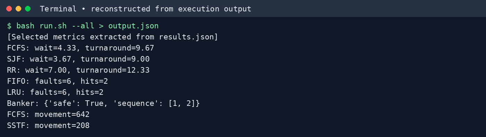
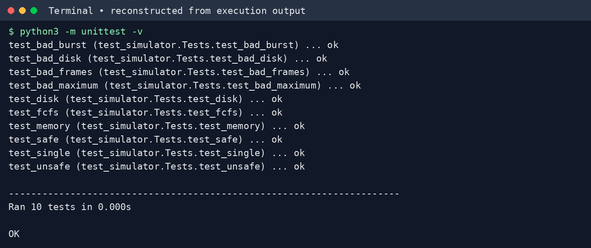

# Operating System Resource Management Simulator

An integrated Python and Bash educational capstone. The simulator models OS resource-management algorithms without modifying real OS resources.

## Features

- CPU scheduling: FCFS, non-preemptive SJF, Round Robin (quantum 2).
- Memory: FIFO and LRU page replacement.
- Deadlock avoidance: Banker's safety check.
- Disk scheduling: FCFS and SSTF.
- Shared JSON input, interactive menu, execution traces and activity logging.

## Run locally

Requires Python 3.8+ and Bash (Linux, macOS or Windows WSL). No third-party dependencies.

```bash
bash run.sh
bash run.sh --all
python3 -m unittest -v
```

Menu options: 1 CPU, 2 Memory, 3 Deadlock, 4 Disk, 5 All, 0 Exit. Edit `sample.json` to change the workload. Successful runs write `results.json`; activity is appended to `activity.log`.

## Sample results

| CPU algorithm | Mean waiting | Mean turnaround |
|---|---:|---:|
| FCFS | 4.33 | 9.67 |
| SJF | 3.67 | 9.00 |
| RR | 7.00 | 12.33 |

FIFO and LRU each produce 6 faults and 2 hits. Banker reports SAFE (P1, P2). Disk FCFS moves 642 cylinders; SSTF moves 208.

## Repository structure

- `simulator.py`: application and algorithms
- `run.sh`: Bash launcher
- `sample.json`: sample workload
- `test_simulator.py`: ten unit tests
- `evidence/`: execution output, test results, logs and reconstructed terminal illustrations
- `docs/capstone-report.pdf`: original report (contains student details; keep repository private)
- `.github/workflows/tests.yml`: automated GitHub Actions checks

## Demonstration





The terminal illustrations are reconstructions, not screenshots of a student's computer. Raw execution output is provided separately in `evidence/`.

## Assumptions

All CPU arrivals are at time zero, with no context-switch overhead. Memory frames are fixed. Banker checks safety only; an unsafe state does not establish an existing deadlock. Disk requests are static, on cylinders 0–199.

## References

- Silberschatz, Galvin and Gagne, *Operating System Concepts*, 10th edition.
- [Python documentation](https://docs.python.org/3/)
- [GNU Bash manual](https://www.gnu.org/software/bash/manual/)
